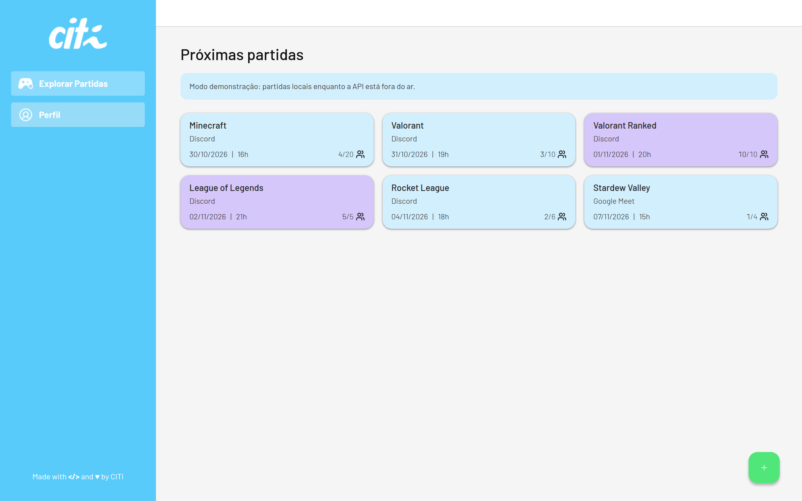
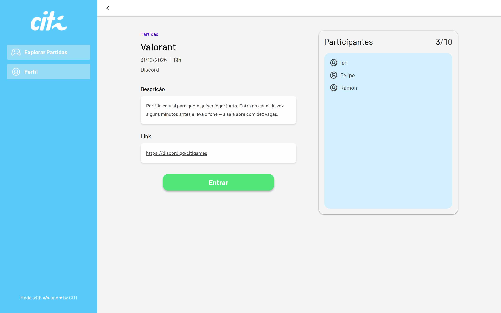
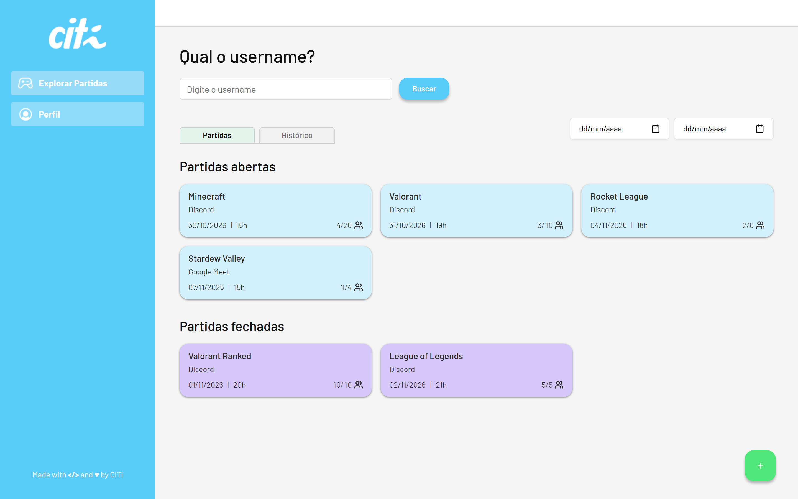
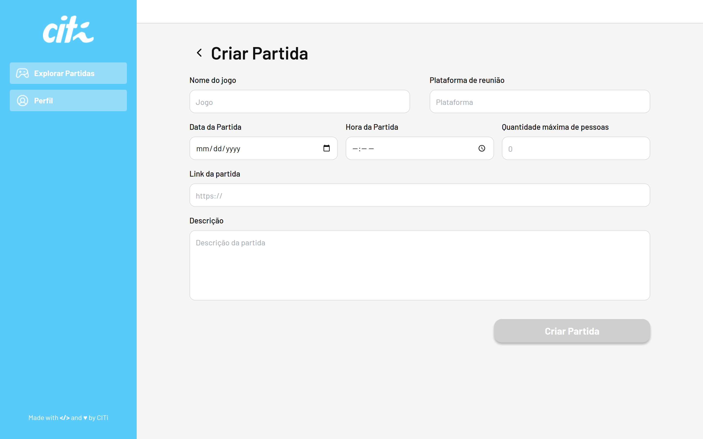
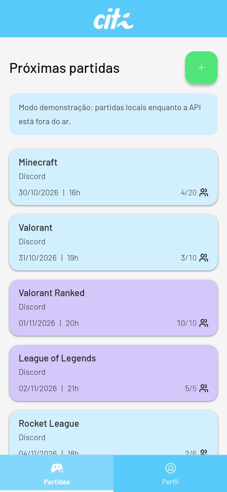
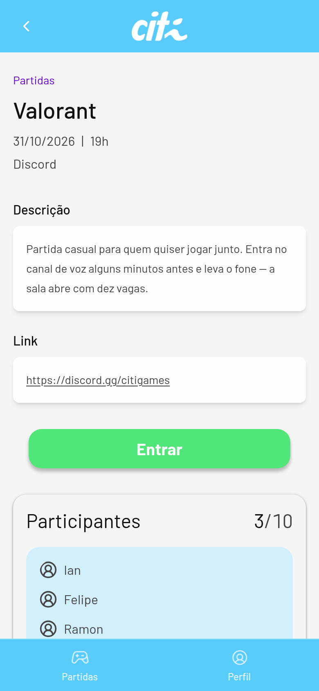
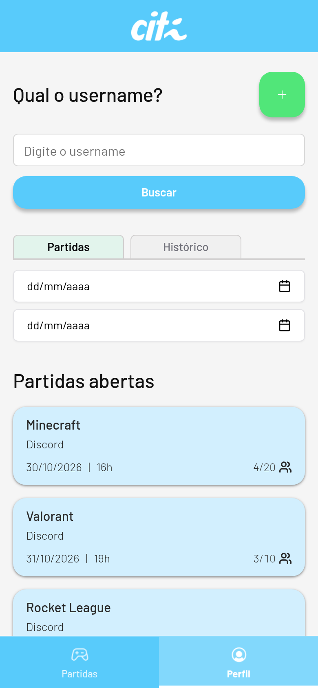
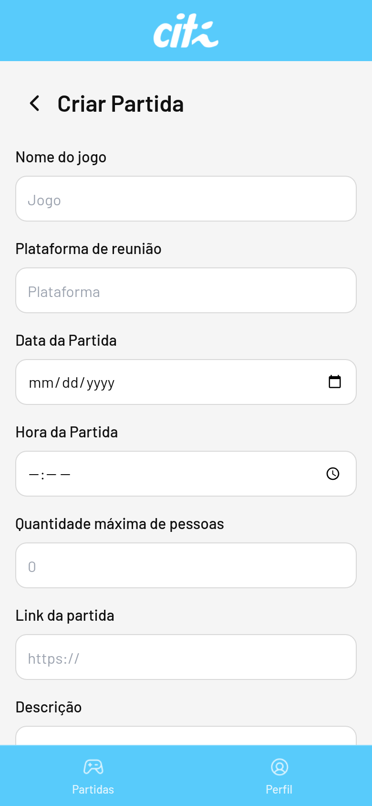

# CITi Games

[](https://nextjs.org/)
[](https://react.dev/)
[](https://www.typescriptlang.org/)
[](https://tailwindcss.com/)
[](https://ui.shadcn.com/)
[](https://citigames-squadian.vercel.app)

Protótipo web de uma plataforma para organizar partidas. A interface saiu de um design no Figma e virou um app em Next.js no processo seletivo de trainees do [CITi](https://citi.org.br), empresa júnior do Centro de Informática da UFPE (CIn-UFPE).

O produto cobre o fluxo de quem marca um jogo e de quem entra nele: listar as próximas partidas, abrir o detalhe, entrar na sala e buscar o histórico de um username.

## Sumário

- [Sobre o projeto](#sobre-o-projeto)
- [Liderança e processo](#liderança-e-processo)
- [Funcionalidades](#funcionalidades)
- [Screenshots](#screenshots)
- [Stack](#stack)
- [Como executar](#como-executar)
- [Estrutura do projeto](#estrutura-do-projeto)
- [Links](#links)

## Sobre o projeto

O CITi Games foi feito entre novembro e dezembro de 2024, na etapa final do processo seletivo de trainees do CITi. O ponto de partida foi um layout no Figma. O repositório entrega o protótipo navegável dessa plataforma: sidebar ciano, tipografia Barlow, cards de partida e os fluxos de criar, entrar e consultar.

Ian Medeiros Melo, então desenvolvedor de software no CITi, liderou o time que construiu o protótipo.

A home (`/`) redireciona para a lista de partidas. Quando a API não responde — que é o caso do deploy estático na Vercel, onde o front chamava `localhost:3001` — o app entra em modo demonstração e mostra partidas locais, salvas no navegador. Com a API no ar e com dados, a lista passa a vir do servidor.

## Liderança e processo

- Ian liderou um time de 3 trainees. Os 3 foram aprovados e entraram no CITi.
- O trabalho seguiu um fluxo baseado em pull requests, com code review.
- O projeto também foi a avaliação de Ian para a vaga de Software Manager, cargo para o qual ele foi promovido.

## Funcionalidades

- **Explorar partidas** — próximas partidas em cards, com data, hora, plataforma e vagas. Azul para sala aberta, roxo para sala lotada.
- **Detalhe da partida** — descrição, link e lista de participantes, com ação de entrar ou sair.
- **Criar partida** — identificação e formulário com validação. A partida criada abre na própria ficha.
- **Perfil** — busca por username, abas de partidas e histórico, e filtro por intervalo de datas.
- **Modo demonstração** — se `GET /match` não retorna partidas, o protótipo continua utilizável sem backend.
- **Layout responsivo** — a sidebar vira barra superior e navegação inferior em telas pequenas, com as mesmas cores e os mesmos destinos.

## Screenshots

### Desktop

Lista de próximas partidas.



Detalhe de uma partida, com descrição, link e participantes.



Busca por username, partidas abertas e partidas fechadas.



Formulário de criação.



### Mobile






## Stack

| Camada | Tecnologias |
| --- | --- |
| Interface | TypeScript, React 18, Next.js 14 (App Router), Tailwind CSS, shadcn/ui |
| Dados no client | Axios, com fallback local quando a API está indisponível |
| API | Node.js, Express, Prisma, PostgreSQL |
| Deploy | Vercel (diretório raiz do projeto: `client`) |

## Como executar

É preciso Node.js 18 ou superior. Yarn ou npm servem.

### Frontend

```bash
cd client
yarn install
yarn dev
```

Abra [http://localhost:3000](http://localhost:3000). A rota `/` leva para `/games`.

Sem a API, o aviso de modo demonstração aparece e as partidas ficam neste navegador. Criar uma partida, entrar e sair continuam funcionando.

Na raiz do repositório, os mesmos comandos estão disponíveis:

```bash
yarn --cwd client dev
yarn --cwd client lint
yarn --cwd client typecheck
yarn --cwd client build
```

`lint`, `typecheck` e `build` precisam passar antes de considerar o client pronto.

### API (opcional)

O front não depende da API para a demonstração. Para subir o backend:

```bash
cd server
cp .env.example .env
docker compose up db -d
yarn install
yarn migration:deploy
yarn dev
```

A API escuta em [http://localhost:3001](http://localhost:3001). O client usa essa URL por padrão (`NEXT_PUBLIC_API_URL` em `client/.env.example`). Com partidas gravadas no Postgres, a lista deixa o modo demonstração e passa a usar o servidor.

### Deploy

No projeto da Vercel, o **Root Directory** é `client`. Depois do merge, um novo deploy publica o redirect da home e o modo demonstração. Enquanto a API pública não existir, o site mostra as partidas locais em vez de uma tela vazia.

## Estrutura do projeto

```text
.
├── client/                 # Next.js — telas do protótipo
│   └── src/
│       ├── app/            # rotas: /games, /profile, /CreateGame, /[id]
│       ├── components/     # sidebar, cards, dialogs, shell
│       └── lib/            # partidas, formato de data, fallback de API
├── server/                 # Express + Prisma
│   ├── prisma/             # schema e migrations
│   └── src/                # rotas de partidas e jogadores
└── docs/screenshots/       # capturas desktop e mobile
```

## Links

- Deploy: [citigames-squadian.vercel.app](https://citigames-squadian.vercel.app)
- Repositório: [github.com/iianmelo/citigames-squadian](https://github.com/iianmelo/citigames-squadian)
- CITi: [citi.org.br](https://citi.org.br)
- Autor: [Ian Medeiros Melo](https://github.com/iianmelo)
